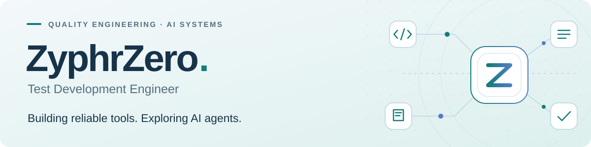

  <picture>
    <source media="(prefers-color-scheme: dark)" srcset="./assets/profile-dark.svg" />
    
  </picture>

  <strong>Quality engineering · Developer tools · AI agents &amp; harnesses</strong> 
  China &nbsp; / &nbsp; UTC+8 &nbsp; / &nbsp; 中文 · English

  <a href="#about-me">About</a> &nbsp; · &nbsp;
  <a href="#ai-agents--harnesses">Research</a> &nbsp; · &nbsp;
  <a href="#toolbox">Toolbox</a> &nbsp; · &nbsp;
  <a href="https://linux.do/u/cassianvale/summary">长秋 · LINUX DO</a>

## About me

I'm a **Test Development Engineer** from China, focused on quality engineering, automation, and developer tools. I enjoy understanding how systems work and turning that understanding into practical tools.

My testing background shapes how I build: make behavior observable, handle failures thoughtfully, and verify that the result actually works.

## AI agents & harnesses

**AI agents and agent harnesses are a long-term research interest of mine.** I keep studying their internals and experimenting with the systems that connect models, tools, context, and people.

<table>
  <tr>
    <th width="33%" align="left">Execution &amp; orchestration</th>
    <th width="34%" align="left">Context &amp; memory</th>
    <th width="33%" align="left">Reliability &amp; feedback</th>
  </tr>
  <tr>
    <td valign="top">Agent loops, tool calls, approval boundaries, cancellation, and coordination across tasks.</td>
    <td valign="top">Context assembly, reusable skills, persistent state, and continuity across sessions.</td>
    <td valign="top">Event traces, session replay, failure recovery, and tests that verify task completion.</td>
  </tr>
</table>

I learn by reading source code, experimenting with agent runtimes, and bringing AI into everyday development workflows.

## Toolbox

**Languages** &nbsp; `Rust` `Python` `TypeScript / JavaScript` `C#` `Go`

**Testing & delivery** &nbsp; `pytest` `Playwright` `Selenium` `Allure` `GitHub Actions` `Docker`

**Apps & services** &nbsp; `React` `Tauri` `WPF` `FastAPI`

## Community

On LINUX DO, you'll find me as [**长秋**](https://linux.do/u/cassianvale/summary). I share practical notes and discuss AI coding tools, automation, deployment, and desktop development.

Always happy to compare notes on agent harnesses, test tooling, and useful developer tools.

## GitHub activity

  <picture>
    <source media="(prefers-color-scheme: dark)" srcset="https://github-readme-stats-eight-psi-43.vercel.app/api?username=ZyphrZero&amp;locale=en&amp;show_icons=true&amp;rank_icon=github&amp;hide_border=true&amp;border_radius=12&amp;title_color=64d8c3&amp;icon_color=8ab5f4&amp;text_color=afc2d0&amp;bg_color=0d1724&amp;cache_seconds=86400" />
    
  </picture>
  <picture>
    <source media="(prefers-color-scheme: dark)" srcset="https://github-readme-stats-eight-psi-43.vercel.app/api/top-langs?username=ZyphrZero&amp;locale=en&amp;layout=compact&amp;langs_count=8&amp;hide_border=true&amp;border_radius=12&amp;title_color=64d8c3&amp;icon_color=8ab5f4&amp;text_color=afc2d0&amp;bg_color=0d1724&amp;cache_seconds=259200" />
    
  </picture>

